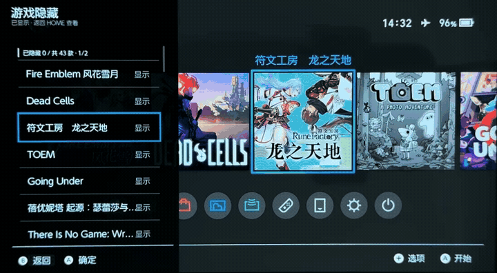

English | [简体中文](README.zh-CN.md)

Hide and restore games in the Nintendo Switch HOME menu through Tesla. 
Games and saves are kept.

[Installation](#installation) · [Usage](#usage) · [Hiding scope](#hiding-scope) · [Uninstallation](#uninstallation) · [Docs and feedback](#docs-and-feedback)

 

## Installation

Requires [Atmosphère](https://github.com/Atmosphere-NX/Atmosphere), [Tesla Menu](https://github.com/WerWolv/Tesla-Menu) and [nx-ovlloader](https://github.com/WerWolv/nx-ovlloader).

Tested on HOS 22.5.0 / Atmosphère 1.11.2.

1. Download `NX-GameHide-v<version>.zip` from [Releases](https://github.com/chuthree/nx-gamehide/releases).
2. Extract it to the SD card root.
3. Fully reboot the console.

## Usage

Close the game before changing its visibility.

1. Open **GameHide** in Tesla.
2. Select a game and press **A** to hide or show it.

Choose **Show all games** to clear the hidden list and show all games.

## Hiding scope

The following results were verified on a console. Games remain hidden after a full reboot.

| Interface | Visibility while hidden |
| --- | --- |
| HOME game list | Not shown |
| Groups | Not shown |
| Settings → Data Management → Software Details | Not shown |
| Settings → Data Management → Delete Save Data | Shown |
| Other launchers | Not tested |

If you open Groups while a game is hidden, you must manually add it back to its groups after showing it again. Its group membership is preserved if you do not open Groups while it is hidden.

## Uninstallation

Delete the following file and directory from the SD card, then fully reboot the console. Games reappear in HOME.

- `switch/.overlays/nx-gamehide.ovl`
- `atmosphere/contents/00FF48474D000001`

Keep `config/nx-gamehide` to preserve the hidden list, or delete it to remove the saved settings.

## Docs and feedback

- [Troubleshooting](docs/troubleshooting.md)
- [Building](docs/build.md)
- [Report an issue](https://github.com/chuthree/nx-gamehide/issues)

## License

[GPL-2.0-only](LICENSE). Third-party notices are included in the installation package. See [Building](docs/build.md) for source and dependency details.
